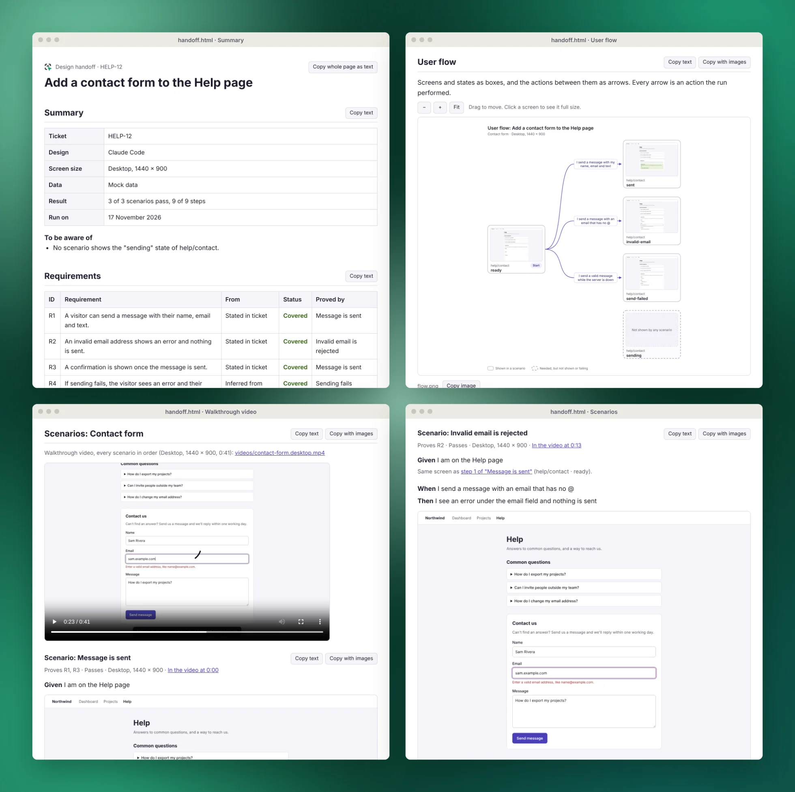

<p></p>

[](https://github.com/brendanciccone/specsheet/actions/workflows/ci.yml)

**Turn a ticket and a design into everything engineering needs.**

Give Claude a ticket and a design that runs in a browser. You get back a user flow, a
walkthrough video, Gherkin or a checklist with a screenshot beside every step, and the
states the design is missing. Every step is run against the design, so the spec matches it.



Free and open source, under the MIT license.

## Install

In Claude Code, run:

```
/plugin install specsheet --marketplace brendanciccone/specsheet
```

That is the only install. You also need [Node](https://nodejs.org) 20 or later.

## Use

In the project that holds your design, ask Claude:

> Hand off the contact form for HELP-12.

The skill takes it from there. The first time, it adds Specsheet to the project and
downloads a browser, after asking you. Then it confirms the setup, lists the requirements
for your approval, writes and runs the scenarios, and goes through what it found with you.

You get `handoff/HELP-12/out/handoff.html`: one file with the screenshots and video
inside, and a copy button on every section. Claude can also post it to Jira as a
comment, always after showing you a preview.

A design made in Claude Code already runs in a browser. For Claude Design, Paper or
Figma, Claude builds a prototype from it first.

## See it first

Run the example in this repository:

```bash
git clone https://github.com/brendanciccone/specsheet.git
cd specsheet
npm install
npx playwright install chromium
npm run example
```

Then open `examples/contact-form/handoff/HELP-12/out/handoff.html`. The example's design
has no loading state for sending a message, and the handoff reports that.

## Status

A first version. It works on the example here, and has not yet been tried on a real
ticket. The [reference](docs/reference.md) covers the commands, the scenario format,
every output file, Jira and the known limits. [CONTRIBUTING.md](CONTRIBUTING.md) covers
working on Specsheet and releasing it.
